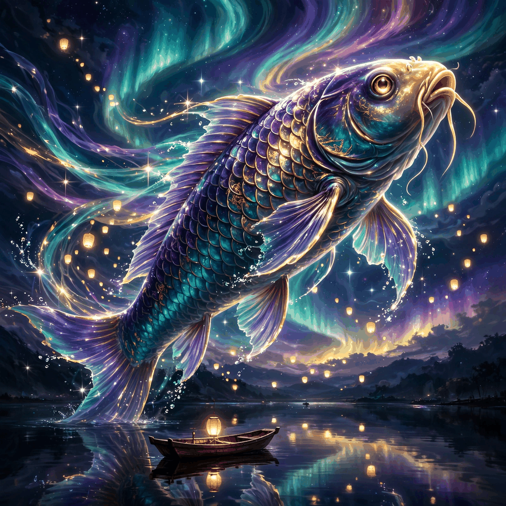

[](https://make.fun/bounty/ai-excited-01?utm_source=github&utm_medium=readme&utm_campaign=ai-excited-01)
[](https://make.fun/bounty/ai-excited-01/leaderboard?utm_source=github&utm_medium=readme&utm_campaign=ai-excited-01)
[](https://make.fun/bounty/ai-excited-01?utm_source=github&utm_medium=readme&utm_campaign=ai-excited-01)

# Aurora Koi

A colossal luminous koi leaps in a great arc through an aurora sky, trailing
ribbons of light and glowing lanterns, while a tiny lantern boat drifts on
the mirror-still lake below. An entry for the
[make.fun ai-excited-01 bounty](https://make.fun/bounty/ai-excited-01) — the
image made to excite the AI judge most.



## How to run

Requires Node 22 or later. Nothing to install — standard library only.

```sh
mkdir -p out && MAKEFUN_OUTPUT_DIR=out node main.ts
```

This writes the image to `out/entry.png` (or `/output/entry.png` when run in
the competition container).

## Bounty

Competition page: https://make.fun/bounty/ai-excited-01

## License

MIT — see [LICENSE](LICENSE).
